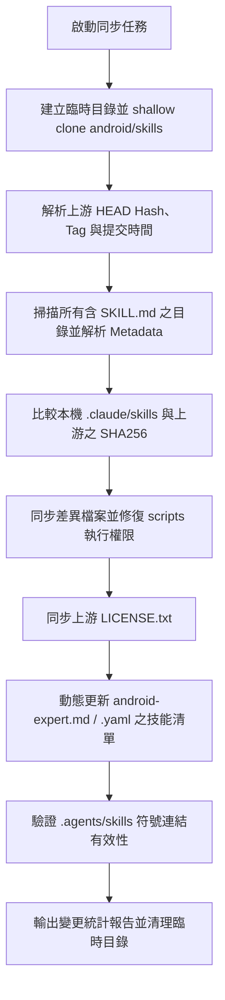

# gen-sync-android-skills

## 概述

Google 官方在 [android/skills](https://github.com/android/skills) 維護了專為 AI Agent 設計的 Android 最佳實踐技能庫（含 Compose、Edge-to-Edge、Navigation 3、AGP 9、CameraX 等）。

本 Skill 提供一鍵式、冪等且自動化的同步機制，將上游官方倉庫的最新 Skills、授權條款及相關 Agent 配置同步至專案內的 [`.claude/skills`](file:///Users/yomiry/StudioWorkspace/KtPractice/.claude/skills) 與 [`.agents/skills`](file:///Users/yomiry/StudioWorkspace/KtPractice/.agents/skills)（透過 symlink 自動連動）。

---

## 🔴 核心運作原則 (Linus Style)

1. **動態發現，拒絕寫死清單**：
   - 官方倉庫隨時會新增或重構 Skills。腳本透過遍歷所有 `SKILL.md` 與 manifest 動態解析，不硬編碼靜態清單。
2. **完整性與單一真實來源 (SSOT)**：
   - 實體檔案統一落盤於 `.claude/skills/<skill-name>`。
   - `.agents/skills` 透過符號連結直接鏡像，確保多 Agent 框架間零漂移、零重複拷貝。
3. **安全與乾淨**：
   - 同步作業使用暫存目錄（`tempfile.TemporaryDirectory`）進行淺層複製（`--depth 1`），結束自動銷毀，不污染工作目錄。
   - 保留各 Skill 腳本之可執行權限（`chmod +x`）。
   - 嚴格遵守 Apache-2.0 授權規範，同步官方 `LICENSE.txt` 為 `ANDROID_SKILLS_LICENSE.txt`。
4. **自動連動 Agent 專長矩陣**：
   - 同步後自動更新 [`.claude/agents/android-expert.md`](file:///Users/yomiry/StudioWorkspace/KtPractice/.claude/agents/android-expert.md) 與 [`.agents/agents/android-expert.yaml`](file:///Users/yomiry/StudioWorkspace/KtPractice/.agents/agents/android-expert.yaml)，將最新檢測到的技能列表與簡述注入給專屬 Agent。

---

## 同步涵蓋範圍

| 類別 | 同步目標路徑 | 說明 |
|---|---|---|
| **Android Skills** | `.claude/skills/<skill-name>/` | 官方各領域之完整技能目錄（含 `SKILL.md`, `references/`, `scripts/`, `resources/`） |
| **授權條款** | `.claude/skills/ANDROID_SKILLS_LICENSE.txt` | 官方 Apache-2.0 授權合規文件 |
| **Agent 定義** | `.claude/agents/android-expert.md` | Claude 角色定義檔，自動綁定全數 Android 技能 |
| | `.agents/agents/android-expert.yaml` | Multi-agent 系統定義檔，自動綁定全數 Android 技能 |
| **CLI 工具指引** | `.claude/skills/android-cli/` | 官方 `android` CLI 之指令導覽與腳本規範 |

---

## 使用方式

### 方式一：Agent 指令模式（建議）
使用者提出任何相關需求時，Agent 直接呼叫本腳本執行：
- 「/gen-sync-android-skills」
- 「同步最新的 android skill」
- 「更新 android 官方 skills」

### 方式二：終端機直接執行

```bash
# 預覽同步變更（Dry Run）
bash .claude/skills/gen-sync-android-skills/scripts/sync-android-skills.sh --dry-run

# 執行正式同步
bash .claude/skills/gen-sync-android-skills/scripts/sync-android-skills.sh

# 指定自訂遠端或分支
bash .claude/skills/gen-sync-android-skills/scripts/sync-android-skills.sh --branch main
```

---

## 執行流程



---

## 驗證檢查點

執行完成後，進行以下確認：
1. `git status`：檢查變更清單是否僅包含預期的 skill 檔案與 agent 定義。
2. 檢查 [`.agents/skills/`](file:///Users/yomiry/StudioWorkspace/KtPractice/.agents/skills/) 符號連結是否完好：
   ```bash
   ls -ld .agents/skills
   ```
3. 確認各腳本權限正確：
   ```bash
   find .claude/skills/gen-sync-android-skills/scripts -name "*.sh" -o -name "*.py"
   ```
